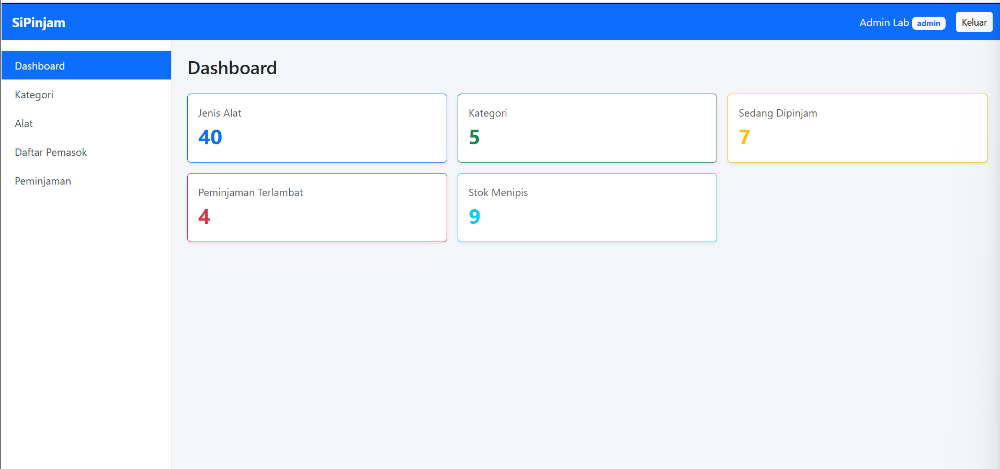
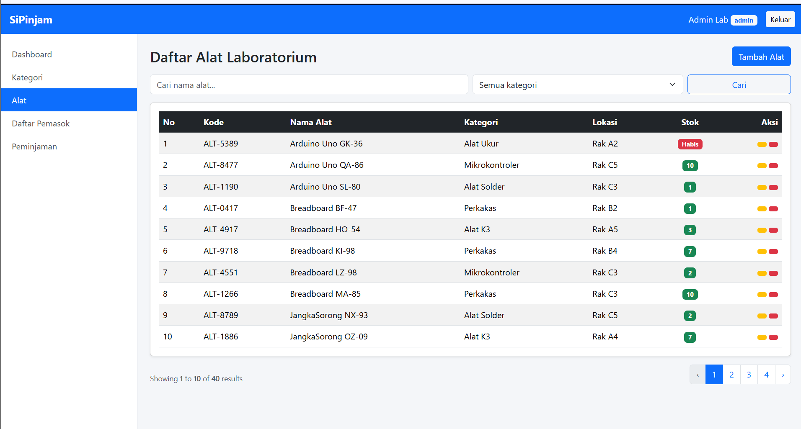
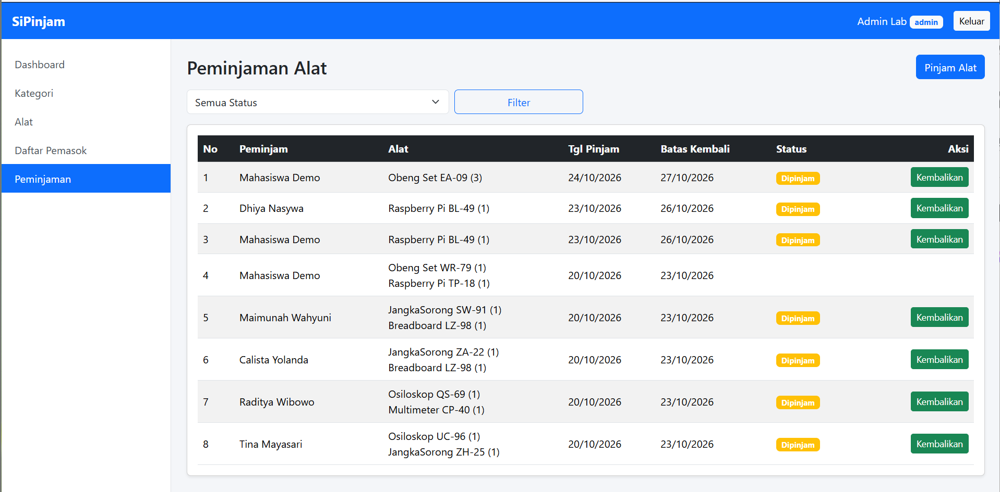

# SiPinjam

SiPinjam adalah aplikasi peminjaman alat laboratorium berbasis Laravel. Admin dapat mengelola data alat dan kategori, sedangkan mahasiswa dapat melihat daftar alat yang tersedia, mengajukan peminjaman, dan memantau riwayat peminjamannya. Aplikasi ini juga menyediakan REST API berbasis token Laravel Sanctum, sehingga data SiPinjam dapat dipakai oleh aplikasi lain seperti aplikasi mobile.

## Pembuat

- Nama: Dhiya Nasywa N.S.M
- NIM: 225443030

## Langkah Instalasi

Pastikan Laragon (Apache dan MySQL) sudah menyala sebelum memulai.

1. Clone repository:

   ```
   git clone https://github.com/dys006/sipinjam.git
   cd sipinjam
   ```

2. Pasang paket:

   ```
   composer install
   ```

3. Salin file pengaturan:

   ```
   copy .env.example .env
   ```

4. Buat kunci aplikasi:

   ```
   php artisan key:generate
   ```

5. Buat database `peminjaman225443030dhiya` di phpMyAdmin, lalu sesuaikan `DB_DATABASE` di file `.env` jika namanya berbeda.

6. Jalankan migration dan seeder:

   ```
   php artisan migrate --seed
   ```

7. Jalankan aplikasi:

   ```
   php artisan serve
   ```

   Buka http://127.0.0.1:8000

## Akun Uji

| Peran     | Email               | Password |
|-----------|---------------------|----------|
| Admin     | admin@sipinjam.test | password |
| Mahasiswa | mhs@sipinjam.test   | password |

## Tampilan Aplikasi




## Endpoint API

Semua alamat diawali `/api`.

| Method | Alamat          | Gunanya                                  | Akses       |
|--------|-----------------|------------------------------------------|-------------|
| GET    | /api/halo       | Tes API pertama                          | Publik      |
| GET    | /api/kategori   | Daftar kategori dan jumlah alatnya       | Publik      |
| GET    | /api/alat       | Daftar alat (bisa ?cari= dan ?kategori=) | Publik      |
| GET    | /api/alat/{id}  | Detail satu alat                         | Publik      |
| POST   | /api/login      | Login, mendapat token                    | Publik      |
| GET    | /api/me         | Data pengguna pemilik token              | Token       |
| POST   | /api/logout     | Mematikan token                          | Token       |
| GET    | /api/peminjaman | Riwayat peminjaman milik sendiri         | Token       |
| POST   | /api/peminjaman | Mengajukan peminjaman                    | Token       |
| POST   | /api/alat       | Tambah alat                              | Token admin |
| PUT    | /api/alat/{id}  | Ubah alat                                | Token admin |
| DELETE | /api/alat/{id}  | Hapus alat                               | Token admin |

### Contoh Respons `GET /api/alat`

```json
{
    "data": [
        {
            "id": 13,
            "code": "ALT-5389",
            "name": "Arduino Uno GK-36",
            "stock": 2,
            "available": true,
            "stock_label": "Menipis",
            "location": "Rak A2",
            "category": "Alat Ukur"
        }
    ],
    "links": {
        "first": "http://sipinjam.test/api/alat?page=1",
        "last": "http://sipinjam.test/api/alat?page=4",
        "prev": null,
        "next": "http://sipinjam.test/api/alat?page=2"
    },
    "meta": {
        "current_page": 1,
        "last_page": 4,
        "per_page": 10
    }
}
```

Token dikirim lewat header `Authorization: Bearer <token>`.

Collection Postman ada di `docs/SiPinjam.postman_collection.json`.
